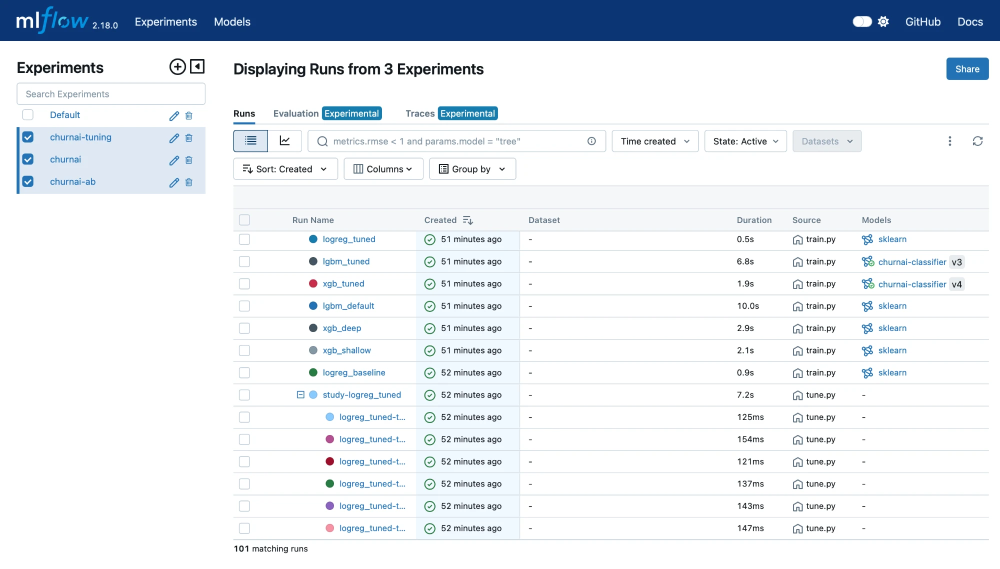
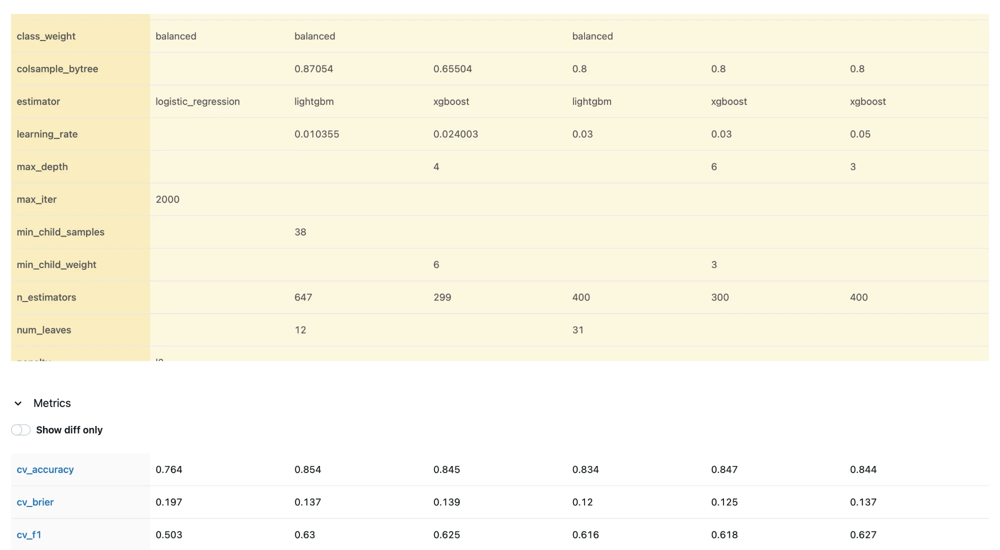
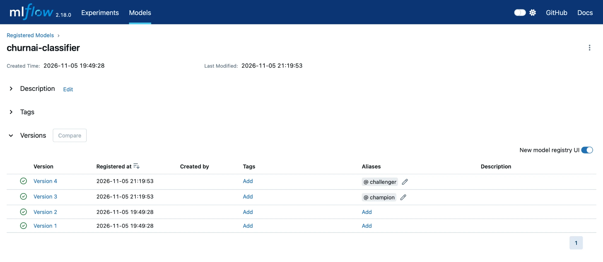
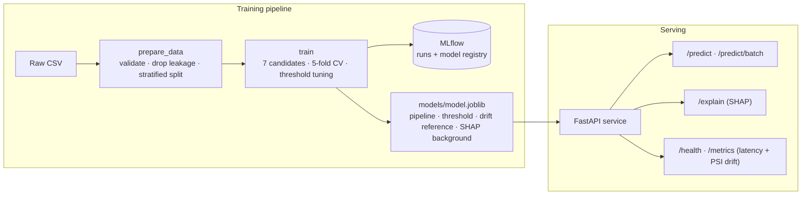

# ChurnAI

[](https://github.com/gehna88/MLOps_ChurnAI-/actions/workflows/ci.yml)

**An end-to-end MLOps pipeline for bank customer churn prediction.**

ChurnAI takes a churn classifier from raw CSV to a tested, explainable, monitored
prediction API. It predicts whether a bank customer will close their account, explains
*why* with SHAP, and watches live traffic for data drift. The focus is on the full loop
(reproducibility, testing, tracking, serving and monitoring) rather than squeezing out
the last point of accuracy.

**Project focus: A/B testing and data drift.** A/B testing is covered in
[Milestone 1](#hyperparameter-tuning-and-ab-testing); the full data drift study is planned
for [Milestone 2](#roadmap).

> MLOps course project · BS Computer Science, Fall 2026 · Gehna Bhatia (29054), M. Zayed Nauman (29047)

---

## Contents

- [Milestone 1 submission map](#milestone-1-submission-map)
- [Results](#results)
- [Best MLflow run](#best-mlflow-run)
- [SHAP in MLflow](#shap-in-mlflow)
- [Hyperparameter tuning and A/B testing](#hyperparameter-tuning-and-ab-testing)
- [Architecture](#architecture)
- [Quickstart](#quickstart)
- [Commands](#commands)
- [API](#api)
- [Project structure](#project-structure)
- [Key design decisions](#key-design-decisions)
- [Configuration](#configuration)
- [Testing](#testing)
- [Roadmap](#roadmap)
- [Contributors](CONTRIBUTION.md)

---

## Milestone 1 submission map

Where to find each Milestone 1 requirement (tag `v1.0-milestone1`):

| Requirement | Where |
|---|---|
| Pitch, architecture diagram, quick start, dataset and task | This README: [top](#churnai), [Architecture](#architecture), [Quickstart](#quickstart), [Dataset](#dataset-and-task) |
| Data preparation, separate from training, with validation | [`src/churnai/pipelines/prepare_data.py`](src/churnai/pipelines/prepare_data.py), [`src/churnai/data/validation.py`](src/churnai/data/validation.py) |
| Training script: held-out evaluation, versioned model artefact | [`src/churnai/pipelines/train.py`](src/churnai/pipelines/train.py) writes `models/<model>-v<version>-<run>.joblib` and `models/model.joblib` |
| MLflow: 3+ runs, params and metrics, best run justified | One run per candidate (7 per training); see [Best MLflow run](#best-mlflow-run) and [A/B testing](#hyperparameter-tuning-and-ab-testing) |
| FastAPI service with `/predict`, Pydantic validation, `/docs` | [`src/churnai/api/app.py`](src/churnai/api/app.py) (app factory), [`routes.py`](src/churnai/api/routes.py), [`schemas.py`](src/churnai/api/schemas.py) |
| pytest: data prep, model loading, prediction endpoint | [`tests/test_prepare_data.py`](tests/test_prepare_data.py), [`tests/test_training.py`](tests/test_training.py), [`tests/test_api.py`](tests/test_api.py); how to run in [Testing](#testing) |
| Names, ERP IDs and member-to-task table | [`CONTRIBUTION.md`](CONTRIBUTION.md) |
| AI tools used, for what, and our review | [`AI_USAGE.md`](AI_USAGE.md) |
| CI pipeline | [`.github/workflows/ci.yml`](.github/workflows/ci.yml): runs on Python 3.11 on every pull request and push to `main` (see [Continuous integration](#continuous-integration)) |

> The FastAPI app lives in the `churnai` package (`src/churnai/api/app.py`) rather than a
> loose `src/app.py`, so it is importable, installable and testable like the rest of the code.

---

## Dataset and task

- **Data:** [Bank Customer Churn](https://www.kaggle.com/datasets/radheshyamkollipara/bank-customer-churn)
  by Radheshyam Kollipara (Kaggle). It covers 10,000 customers of a European bank in France,
  Germany and Spain, with 18 columns: demographics, balance, products, activity, card
  type, satisfaction and loyalty points. It is stored at `data/raw/Customer-Churn-Records.csv`.
- **Task:** binary classification. Predict `Exited` (1 means the customer closed their
  account). About 20% of customers churned.
- **Excluded columns:**
  - `RowNumber`, `CustomerId` and `Surname` are identifiers, dropped so the model cannot
    memorise customers.
  - `Complain` is target leakage (see [Results](#results)).
- **Primary metric:** ROC-AUC, because the classes are imbalanced and retention teams rank
  customers by risk. Recall, precision and F1 on the churn class are logged alongside it.

---

## Results

Seven candidates are compared with 5-fold stratified cross-validation on the training split:
four hand-picked settings plus three tuned with Optuna. The champion is chosen by
**CV ROC-AUC only**, and the held-out test set (20%) gives the final estimate. It is never used
to select the model or tune the threshold.

| Model | CV ROC-AUC | Test ROC-AUC | Test PR-AUC | Test recall | Test precision |
|---|---|---|---|---|---|
| **LightGBM tuned, champion** | **0.8642** | **0.8779** | 0.7279 | 0.647 | 0.630 |
| XGBoost tuned, challenger | 0.8636 | 0.8768 | 0.7260 | 0.677 | 0.601 |
| XGBoost (shallow) | 0.8610 | 0.8749 | 0.7253 | 0.679 | 0.589 |
| XGBoost (deep) | 0.8597 | 0.8713 | 0.7217 | 0.642 | 0.615 |
| LightGBM (default) | 0.8580 | 0.8680 | 0.7131 | 0.694 | 0.564 |
| Logistic Regression tuned | 0.7675 | 0.7786 | 0.4635 | 0.615 | 0.436 |
| Logistic Regression (baseline) | 0.7663 | 0.7771 | 0.4736 | 0.593 | 0.459 |

- **Trees beat the linear baseline** by about **0.10 AUC**, because churn depends on non-linear
  effects such as age and number of products.
- **The champion's threshold is 0.65,** tuned on out-of-fold predictions to maximise F1. At that
  threshold it catches 65% of churners, and 63% of the customers it flags really leave.
- **The estimates look reliable.** CV and test scores agree, and the champion's train-test
  accuracy gap is small: 86.9% vs 85.1%. Any test AUC above 0.95 would abort training as
  suspected leakage.
- **The top three are statistically tied.** See the
  [A/B testing results](#hyperparameter-tuning-and-ab-testing).

These numbers come from one run on macOS with Python 3.12. Results vary slightly by machine: the
Milestone 1 `xgb_shallow` run, on Windows, scored CV 0.8618 and test 0.8720.

**Data findings** (from `make profile`, see `reports/data_profile.md`):

- `Complain` predicts churn almost perfectly on its own (single-feature AUC **0.998**). It
  is a consequence of churn, not a cause, so it is excluded. A test guarantees it can never
  reach training.
- About 36% of customers hold a zero balance. That is a real behavioural segment, so it is
  kept and flagged as an engineered feature.
- Classes are imbalanced (about 20% churn). This is handled with a stratified split and
  class weights (`scale_pos_weight` / `class_weight`).

---

## Best MLflow run

Every `make train` logs **one MLflow run per candidate** (7 runs) to the `churnai` experiment.
Each run records:
- the model family and hyperparameters
- CV and test metrics: ROC-AUC, PR-AUC, F1, recall, precision, accuracy and Brier score
- the tuned threshold, the confusion matrix, the fitted model and SHAP plots

The champion is registered as `churnai-classifier` with the alias `champion`, and the runner-up
with the alias `challenger`.

**Best run: `lgbm_tuned`**

| | |
|---|---|
| MLflow run ID | `df37651df4af4ce59381be0ca5e992a1` |
| Registry version | `churnai-classifier` **v3** (`@champion`) |
| Served as | `lgbm_tuned-v3-df37651d` (returned in every `/predict` response) |
| Hyperparameters | `n_estimators=647, num_leaves=12, learning_rate=0.010355, subsample=0.872595, subsample_freq=1, colsample_bytree=0.87054, min_child_samples=38, class_weight=balanced` |
| CV ROC-AUC (selection metric) | **0.8642** |
| Test ROC-AUC (held-out) | **0.8779** |
| Decision threshold | 0.65 (tuned on out-of-fold predictions for F1) |

**Why this run wins:**

1. **It has the highest cross-validated ROC-AUC.** ROC-AUC is the primary metric because
   classes are imbalanced and retention teams rank customers by risk. Selection uses CV on
   the training split only.
2. **It ranks customers best on the held-out test,** with the highest test ROC-AUC (0.8779) and
   PR-AUC (0.7279) of the seven candidates.
3. **It overfits little.** Its train-test accuracy gap is 1.8 points, compared with 10.4 points
   for default LightGBM.
4. **It clearly beats the interpretable baseline.** Logistic Regression scores 0.7663, so the
   gain over a linear model is about 0.10 AUC.

The lead is small. The [A/B tests](#hyperparameter-tuning-and-ab-testing) find a statistical tie
with `xgb_tuned` and `xgb_shallow`, so `lgbm_tuned` is the best of a tied group, not a clear
winner.

**Reproduce and inspect:**

```bash
make data && make tune && make train   # logs the runs and registers new versions
make mlflow-ui                         # http://127.0.0.1:5000
```

Runs across the tuning, training and A/B experiments:



Hyperparameters and metrics compared across candidates:



Registry with the `champion` and `challenger` aliases:



> **Note on the MLflow requirement for LLM projects:** ChurnAI is a classical tabular ML
> project, so experiments compare *training runs* (model families and hyperparameters)
> rather than prompts, LLMs or temperature settings.

---

## SHAP in MLflow

Every candidate run in the `churnai` experiment has a `shap/` folder in its **Artifacts** tab:

| File | Shows |
|---|---|
| `shap_bar.png` | Average impact of each feature on the model's output |
| `shap_beeswarm.png` | How each feature's values push churn risk up or down, one dot per customer |
| `shap_importance.csv` | The mean absolute SHAP value of each feature |

`make train` logs these automatically. `make shap-backfill` adds them to older runs, and only
adds files: params, metrics, models and aliases stay the same. Runs that already have a report
are skipped. Tuning trials store no model, so they have no report.

Values are in log-odds and use up to 2,000 rows of the training split, so the test split stays
untouched. Text features such as `Geography` are grey in the beeswarm because they have no
low-to-high scale. For one customer's explanation, use `POST /explain`.

**What the champion (`lgbm_tuned`) relies on:** `NumOfProducts` (0.718) and `Age` (0.714) lead,
followed by `IsActiveMember` (0.351) and `Gender` (0.250). Customers with 3 or 4 products get by
far the largest push towards churn. Logistic regression gives `NumOfProducts` almost no weight
(0.039), because the effect is not linear; this helps explain why the tree models beat it.
SHAP shows what drives the model's predictions, not what causes customers to leave.

---

## Hyperparameter tuning and A/B testing

Three steps, all tracked in MLflow on the current dataset:

```bash
make tune        # MLflow experiment churnai-tuning
make train       # MLflow experiment churnai
make compare     # MLflow experiment churnai-ab (offline A/B)
make ab-online   # MLflow experiment churnai-ab (simulated online A/B)
```

**Result: `lgbm_tuned` is the champion, but it is statistically tied with `xgb_tuned` and
`xgb_shallow`.** It is significantly better than `xgb_deep`, `lgbm_default` and both logistic
regressions, so tuning did improve LightGBM. The numbers below come from one run on macOS with
Python 3.12; AUCs differ slightly from the Milestone 1 table above, which came from another
machine.

### 1. Tuning

`make tune` runs one Optuna study per family (30 trials each) on the same 5-fold CV ROC-AUC
that `make train` selects on, using the training split only. The first 10 trials of each study
are random; the TPE sampler uses the results from then on. Each trial is a nested MLflow run
under its family's parent run. Select the trials in the MLflow UI and choose *Compare* for the
parallel-coordinates chart. Search spaces are in `configs/tuning.yaml`.

| Candidate | CV ROC-AUC | Test ROC-AUC | Test F1 | Threshold |
|---|---|---|---|---|
| **`lgbm_tuned` (champion, `@champion`)** | **0.8642** | 0.8779 | 0.639 | 0.65 |
| `xgb_tuned` (runner-up, `@challenger`) | 0.8636 | 0.8768 | 0.637 | 0.61 |
| `xgb_shallow` (Milestone 1 champion) | 0.8610 | 0.8749 | 0.631 | 0.60 |
| `xgb_deep` | 0.8597 | 0.8713 | 0.628 | 0.60 |
| `lgbm_default` | 0.8580 | 0.8680 | 0.622 | 0.51 |
| `logreg_tuned` | 0.7675 | 0.7786 | 0.510 | 0.56 |
| `logreg_baseline` | 0.7663 | 0.7771 | 0.518 | 0.59 |

### 2. Offline A/B: real difference or noise?

`make compare` tests the champion (A) against every other candidate (B). The verdict comes from
5×5 repeated stratified CV with identical folds, using the corrected resampled t-test
(Nadeau–Bengio) with a Holm adjustment for the six comparisons. The test-split columns confirm
the verdict and never select a model. Differences are B − A.

| B | CV AUC (A / B) | t-test p (Holm) | Test AUC diff [95% CI] | McNemar p | Verdict |
|---|---|---|---|---|---|
| `xgb_tuned` | 0.8634 / 0.8636 | 0.86 | −0.0011 [−0.0038, +0.0016] | 0.033 | No significant difference |
| `xgb_shallow` | 0.8634 / 0.8620 | 0.68 | −0.0030 [−0.0074, +0.0015] | 0.004 | No significant difference |
| `xgb_deep` | 0.8634 / 0.8594 | 0.044 | −0.0067 [−0.0119, −0.0019] | 0.20 | A better |
| `lgbm_default` | 0.8634 / 0.8579 | 0.016 | −0.0099 [−0.0161, −0.0044] | <0.001 | A better |
| `logreg_tuned` | 0.8634 / 0.7672 | <0.001 | −0.0994 [−0.1202, −0.0790] | <0.001 | A better |
| `logreg_baseline` | 0.8634 / 0.7658 | <0.001 | −0.1008 [−0.1219, −0.0806] | <0.001 | A better |

How to read this:

- **The lead over `xgb_tuned` disappears on fresh folds:** 0.8642 vs 0.8636 becomes 0.8634 vs
  0.8636. The first gap partly reflects picking the best of 30 trials on those exact folds.
- **The wins may be slightly flattered,** because the champion was itself selected as the highest
  scorer. The `xgb_deep` result (adjusted p = 0.044) is close to the 0.05 line.
- **McNemar compares decisions, not ranking.** The models use different thresholds, so a small
  p-value can simply mean that they trade recall for precision differently.

### 3. Online A/B: splitting traffic

With `ab_test.enabled` (or `CHURNAI_AB_ENABLED=true`), the API serves the bundles behind the
`champion` (A) and `challenger` (B) aliases:

- **Fetching the bundles:** `make ab-fetch` downloads them, so MLflow stays out of the serving
  runtime.
- **Routing:** send `X-Customer-ID`; `sha256(id) % 100 < split_pct` picks B, so a customer always
  gets the same model. Requests without an ID, and `/predict/batch`, stay on A and outside the
  experiment.
- **Response and stats:** `/predict` returns `model_variant`, and `/metrics` reports latency and
  drift per variant.
- **Outcomes:** `POST /feedback` records what really happened. Exposures and outcomes go to
  `logs/ab_*.jsonl`.

`make ab-online` simulates this by replaying the 2,000 test customers through the real routes.
The decision rule is fixed in `configs/config.yaml` before replay: promote B only if the test has
enough power, recall is significantly higher (two-proportion z-test) and cost is no worse.

| | A: `lgbm_tuned` | B: `xgb_tuned` |
|---|---|---|
| Customers / churners | 972 / 208 | 1,028 / 200 |
| Recall | 0.644 | 0.680 |
| Precision | 0.650 | 0.584 |
| Cost per customer (FN 500, FP 50) | 41.77 | 35.85 |

**Verdict: inconclusive (underpowered).**

- **Power:** detecting a 5-point recall change needs 1,451 churners per arm, about 7,122
  customers per arm, or about 14,200 in total. That is more than the whole dataset. The 200
  churners in the smaller arm can only detect about 13 points.
- **Observed differences:** recall differs by +3.6 points (p = 0.45) and cost by −5.92
  (95% CI −17.64 to +5.01). Neither is significant, and the arms hold different customers.
- **Limits of this simulation:** it is a replay of the test split rather than real traffic, the
  costs are illustrative placeholders, and it reuses the test set, so that set is no longer
  completely untouched.

**Shadow mode** (not implemented) is a safer variant: B scores every request while A's answer is
returned. Customers never see B, and both models score the same people, so the comparison is
paired and needs far less data.

---

## Architecture

Two pipelines connected by a single hand-off artefact, the **model bundle**. Every
deployed model maps back to exactly one MLflow run.



**Inside the model pipeline:** feature engineering, then preprocessing (scaling and
one-hot encoding), then the estimator, all in one scikit-learn `Pipeline`. Preprocessing
is saved *inside* the model, so the API cannot drift from training.

---

## Quickstart

Requires **Python 3.11+** and Git. Run everything from the repository root.

**In short:**

```bash
git clone https://github.com/gehna88/MLOps_ChurnAI-.git && cd MLOps_ChurnAI-
make setup && make data && make train && make serve
```

Run these inside an activated virtualenv (step 1 below).

### 0. Clone

```bash
git clone https://github.com/gehna88/MLOps_ChurnAI-.git
cd MLOps_ChurnAI-
```

### 1. Create and activate a virtualenv

**Windows (PowerShell):**

```powershell
python -m venv $env:USERPROFILE\.venvs\churnai
& $env:USERPROFILE\.venvs\churnai\Scripts\Activate.ps1
```

**Linux / macOS:**

```bash
python3 -m venv .venv
source .venv/bin/activate
```

> On Windows, keep the venv outside OneDrive or other synced folders.

### 2. Install, prepare, train, serve

| Step | With `make` | Without `make` |
|---|---|---|
| Install | `make setup` | `pip install -r requirements/dev.txt` then `pip install -e . --no-deps` |
| Prepare data | `make data` | `python -m churnai.pipelines.prepare_data` |
| Train | `make train` | `python -m churnai.pipelines.train` |
| Serve | `make serve` | `uvicorn churnai.api.app:create_app --factory --port 8000` |

Then open **http://127.0.0.1:8000/docs** for interactive API docs.

> **Windows and `make`:** GNU Make is not installed by default. Install it with
> `winget install ezwinports.make` from a non-admin PowerShell (then reopen the terminal),
> or use the *Without `make`* column. Both are equivalent.

---

## Commands

| `make` target | Equivalent command | Purpose |
|---|---|---|
| `setup` | `pip install -r requirements/dev.txt && pip install -e . --no-deps` | Install pinned dependencies and the package |
| `lint` | `ruff check src tests scripts` | Static checks |
| `test` | `pytest` | Full suite (109 tests) |
| `test-fast` | `pytest -m "not slow"` | Unit tests only (seconds) |
| `coverage` | `pytest --cov=churnai --cov-report=term-missing` | Suite with coverage report |
| `check` | lint + test | The gate CI runs |
| `profile` | `python -m churnai.pipelines.profile_data` | EDA report and leakage scan |
| `data` | `python -m churnai.pipelines.prepare_data` | Validate and split data |
| `train` | `python -m churnai.pipelines.train` | Train, track and register the champion |
| `tune` | `python -m churnai.pipelines.tune` | Optuna studies; best params become candidates in `configs/models.yaml` |
| `shap-backfill` | `python -m churnai.pipelines.backfill_shap` | Add SHAP plots to earlier MLflow candidate runs |
| `compare` | `python -m churnai.pipelines.compare_models` | Offline A/B: champion vs every candidate, with statistical tests |
| `ab-fetch` | `python -m churnai.pipelines.fetch_ab_bundles` | Download the champion and challenger bundles from their MLflow aliases |
| `ab-online` | `python -m churnai.pipelines.ab_online` | Simulated online A/B: power check, replay, verdict |
| `pipeline` | data + train | End-to-end retrain |
| `serve` | `uvicorn churnai.api.app:create_app --factory --port 8000` | Run the API |
| `mlflow-ui` | `mlflow ui --backend-store-uri sqlite:///mlflow.db --port 5000` | Browse experiments |
| `clean` | | Remove tool caches |
| `clean-artifacts` | | Remove generated data, models, reports and the MLflow store |

### What each pipeline produces

| Command | Outputs |
|---|---|
| `profile` | `reports/data_profile.md` |
| `data` | `data/processed/{train,test}.csv`, `summary.json`; rejected rows (with reasons) in `data/rejected/` |
| `train` | `models/model.joblib` (served), `models/<model>-v<version>-<run>.joblib` (versioned copy), `models/metadata.json`, `reports/leaderboard.csv`, one MLflow run per candidate (with SHAP plots), champion registered as `churnai-classifier@champion`, runner-up as `@challenger` |
| `tune` | `reports/tuning.csv`, tuned candidates in `configs/models.yaml`, MLflow experiment `churnai-tuning` |
| `compare` | `reports/ab_offline.{csv,md}`, MLflow experiment `churnai-ab` |
| `ab-online` | `reports/ab_online.md`, `logs/ab_*.jsonl`, MLflow experiment `churnai-ab` |

---

## API

| Method | Endpoint | Description |
|---|---|---|
| `POST` | `/predict` | Churn probability, label and model version for one customer |
| `POST` | `/predict/batch` | Same for up to 1,000 customers |
| `POST` | `/explain` | Prediction plus the top 5 features driving it (SHAP, log-odds) |
| `POST` | `/feedback` | Report a customer's real outcome during an A/B test (404 when no test is running) |
| `GET` | `/health` | Liveness and whether a model is loaded |
| `GET` | `/metrics` | Request counts, error counts, latency (avg/p50/p95/p99), drift report; per-variant stats during an A/B test |
| `GET` | `/model` | Full metadata and lineage of the served model |
| `GET` | `/docs` | Interactive Swagger UI |

Invalid input (out-of-range values, unknown categories, missing or extra fields) is
rejected with **422** before it reaches the model. Every response carries an
`X-Request-ID` header, and every request is logged as one JSON line.

### Example: predict

**bash / curl:**

```bash
curl -X POST http://127.0.0.1:8000/predict \
  -H "Content-Type: application/json" \
  -d '{"credit_score": 619, "geography": "France", "gender": "Female", "age": 42,
       "tenure": 2, "balance": 0, "num_of_products": 1, "has_cr_card": 1,
       "is_active_member": 1, "estimated_salary": 101348.88,
       "satisfaction_score": 2, "card_type": "DIAMOND", "point_earned": 464}'
```

**PowerShell:**

```powershell
$c = @{credit_score=619; geography="France"; gender="Female"; age=42; tenure=2; balance=0;
       num_of_products=1; has_cr_card=1; is_active_member=1; estimated_salary=101348.88;
       satisfaction_score=2; card_type="DIAMOND"; point_earned=464} | ConvertTo-Json
Invoke-RestMethod http://127.0.0.1:8000/predict -Method Post -Body $c -ContentType "application/json"
```

**Response:**

```json
{
  "churn_probability": 0.6445,
  "churn_prediction": false,
  "threshold": 0.65,
  "model_version": "lgbm_tuned-v3-df37651d",
  "model_variant": "A"
}
```

`model_version` is `<model>-v<registry version>-<MLflow run id>`, so any prediction can be
traced back to the exact training run. `model_variant` is `A` unless an A/B test routes the
customer to the challenger (`B`).

### Example: explain

`POST /explain` with the same body returns:

```json
{
  "churn_probability": 0.6445,
  "base_value": -0.6654,
  "units": "log_odds",
  "top_features": [
    {"feature": "NumOfProducts",      "value": 1,        "shap_value":  0.728,  "direction": "increases_churn_risk"},
    {"feature": "Age",                "value": 42,       "shap_value":  0.3687, "direction": "increases_churn_risk"},
    {"feature": "IsActiveMember",     "value": 1,        "shap_value": -0.2984, "direction": "decreases_churn_risk"},
    {"feature": "Gender",             "value": "Female", "shap_value":  0.2916, "direction": "increases_churn_risk"},
    {"feature": "BalanceSalaryRatio", "value": 0.0,      "shap_value":  0.113,  "direction": "increases_churn_risk"}
  ]
}
```

One-hot columns are aggregated back to their original feature (for example, every
`Geography=*` column becomes `Geography`). Contributions are additive:
`base_value + Σ shap_value` equals the model's log-odds exactly. A test enforces this for
every model family.

### Input fields

| Field | Type | Allowed values |
|---|---|---|
| `credit_score` | int | 300 – 900 |
| `geography` | string | `France`, `Germany`, `Spain` |
| `gender` | string | `Female`, `Male` |
| `age` | int | 18 – 100 |
| `tenure` | int | 0 – 60 (years with the bank) |
| `balance` | float | 0 – 10,000,000 |
| `num_of_products` | int | 1 – 4 |
| `has_cr_card` | int | 0 or 1 |
| `is_active_member` | int | 0 or 1 |
| `estimated_salary` | float | 0 – 10,000,000 |
| `satisfaction_score` | int | 1 – 5 |
| `card_type` | string | `SILVER`, `GOLD`, `PLATINUM`, `DIAMOND` |
| `point_earned` | int | 0 – 10,000 |

These rules are generated from the same data contract (`src/churnai/data/schema.py`) used
for offline validation, so training-time and serving-time checks are identical.

---

## Project structure

```
ChurnAI/
├── configs/
│   ├── config.yaml            # paths, split, CV, MLflow, explainability, monitoring settings
│   └── models.yaml            # candidate models and hyperparameters
├── data/raw/                  # source dataset (processed outputs are generated, not committed)
├── requirements/              # pinned lock files: serve.txt ⊂ train.txt ⊂ dev.txt
├── scripts/healthcheck.py     # container health check (stdlib only)
├── src/churnai/
│   ├── config.py              # typed, validated settings (pydantic) with env overrides
│   ├── logging_utils.py       # one-line JSON logging
│   ├── exceptions.py          # project exception hierarchy
│   ├── data/                  # schema (data contract), validation, preparation, profiling, io
│   ├── features/              # feature engineering and the shared sklearn Pipeline
│   ├── models/                # model factory, training/selection, evaluation, bundle, MLflow tracking
│   ├── explain/               # SHAP explainer
│   ├── monitoring/            # PSI drift detection, request metrics
│   ├── api/                   # FastAPI app factory, routes, schemas, inference service
│   └── pipelines/             # CLI entry points: profile_data, prepare_data, tune, train, compare_models, ab_online
├── tests/                     # 109 tests
├── Makefile
└── pyproject.toml             # package metadata, ruff and pytest configuration
```

---

## Key design decisions

| Decision | Why |
|---|---|
| **One data contract** (`schema.py`) drives offline validation *and* the API request schema | Training and serving can't disagree about what valid input is |
| **Allow-list of features**, not a deny-list | A new upstream column, even a leaky one, can never silently reach training |
| **Preprocessing inside the model `Pipeline`** | The API reuses exactly the fitted transformations; no serving-side reimplementation |
| **Select on CV, report on test** | Model choice and threshold never see the test set, so the test score is unbiased |
| **Leakage guard** (test AUC > 0.95 aborts training) | Implausibly good results are treated as a bug, not a win |
| **Model bundle** (pipeline + threshold + lineage + drift reference + SHAP background) | One artefact to ship; the API needs nothing else and no MLflow at runtime |
| **`ExperimentTracker` interface** (MLflow or no-op) | Training logic is unit-testable without an MLflow server |
| **Model factory registry** | Adding a model family means registering one builder plus a YAML entry |
| **App factory, no global state** | Each test builds an isolated app with its own model |
| **Graceful degradation** | If the model is missing, the API still starts and `/health` reports `unavailable` instead of crash-looping |
| **Pinned, layered requirements** | `serve.txt` keeps the runtime image lean; training and dev tools stay out of it |

### Drift monitoring

At training time a reference distribution of every feature, and of the predicted
probability, is stored in the bundle. The API keeps a rolling window of the last 500
requests and computes the **Population Stability Index** per feature. PSI > 0.2 flags
drift in `/metrics`. When drift is flagged: retrain (`make pipeline`), compare in MLflow,
then redeploy.

---

## Configuration

All settings live in `configs/config.yaml` and `configs/models.yaml`. Paths are relative
to the project root, so the project runs from any clean clone.

Environment variables override config without editing files:

| Variable | Purpose |
|---|---|
| `CHURNAI_HOME` | Project root (default: current directory) |
| `CHURNAI_CONFIG` | Path to an alternative config file |
| `CHURNAI_MODEL_DIR` | Where the model bundle is read and written |
| `CHURNAI_MLFLOW_TRACKING_URI` | For example, a remote MLflow server |
| `CHURNAI_MLFLOW_ARTIFACT_DIR` | MLflow artifact location |
| `CHURNAI_AB_ENABLED` | `true` serves the champion and challenger as an A/B test |
| `CHURNAI_LOG_LEVEL` | `DEBUG`, `INFO` (default), ... |
| `CHURNAI_LOG_FORMAT` | `json` (default for the API) or `text` |

**To add a model**, append a candidate to `configs/models.yaml`:

```yaml
- name: xgb_wide
  estimator: xgboost          # logistic_regression | xgboost | lightgbm
  params: {n_estimators: 600, max_depth: 4, learning_rate: 0.02, scale_pos_weight: auto}
```

---

## Testing

```bash
make test        # full suite (109 tests)       or: pytest
make test-fast   # unit tests only, seconds     or: pytest -m "not slow"
make coverage    # full suite with coverage     or: pytest --cov=churnai --cov-report=term-missing
```

The three areas the milestone asks for are covered by:
- **Data preparation:** `tests/test_prepare_data.py` and `tests/test_validation.py`
- **Model loading:** `tests/test_training.py`. It covers bundle load and save, the versioned
  copy, and a clear error when no model exists.
- **Prediction endpoint:** `tests/test_api.py`. It covers `/predict`, `/predict/batch`,
  `/explain` and 422 validation.

Tests run against an isolated temporary project (a stratified sample of the real data
plus fast model settings). They never touch your `models/` or `mlflow.db`, and they don't
require `make train` to have been run first.

| Area | What is verified |
|---|---|
| Data | Bad rows rejected with reasons; leakage and identifier columns can never reach training; deterministic stratified split |
| Models | Factory, `scale_pos_weight=auto`, threshold tuning, CV-only selection, leakage guard |
| Explainability | Top-k ordering; additivity for XGBoost, LightGBM and Logistic Regression |
| Monitoring | PSI maths; no false alarm on training-like traffic; detects shifted populations |
| API | All endpoints, 422 validation, batch limits, request-ID propagation, behaviour without a model |
| MLflow | Runs logged, champion registered, bundle lineage matches the registry |

### Continuous integration

[`.github/workflows/ci.yml`](.github/workflows/ci.yml) runs on every pull request to
`main` and every push to `main`, on a fresh Ubuntu machine with **Python 3.11**. Each run proves the
project works from a clean clone:

1. `make setup`: install the pinned dependencies
2. `make lint`: ruff
3. `make test`: the full pytest suite
4. `make profile`, `make data`, `make train`: the full pipeline, including MLflow tracking and registration
5. Start the API, check `/health`, and call `/predict` with a real customer

The training reports and model metadata are uploaded as a downloadable artifact on each
run (**Actions → a run → Artifacts**).

---

## Roadmap

| Milestone | Scope | Status |
|---|---|---|
| **1. Model, API and A/B testing** | Data pipeline, MLflow-tracked training and tuning, A/B testing, FastAPI `/predict` and `/explain`, tests, Makefile, README | ✅ |
| **2. Data drift and deployment** | Data drift study on simulated future years, multi-stage Docker image, extend CI to build and push to GHCR, Render deployment, RUNBOOK, rollback drill | 🔜 |
| **3. Final presentation** | Live demo of pipeline, MLflow, CI and API | ⏳ |

`/health`, `/metrics`, JSON logging and PSI drift monitoring (Milestone 2 scope) are
already implemented.

---

**Team:** Gehna Bhatia (29054) and M. Zayed Nauman (29047). See [CONTRIBUTION.md](CONTRIBUTION.md)
for who did what.
